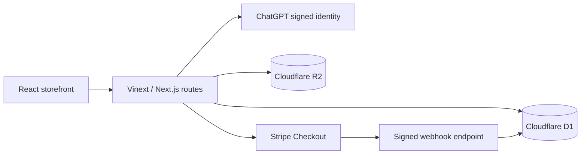

# MoveKit

MoveKit is a full-stack fitness-accessories storefront built as a portfolio project. It demonstrates a complete commerce journey: discover portable equipment, manage a persistent cart and wishlist, pay through Stripe Checkout, follow order fulfillment, and administer products and orders.

## Highlights

- Responsive catalog with search, categories, sorting, stock filters, and product pages
- Persistent cart and device-local wishlist
- Stripe-hosted test checkout with promotion codes and signed webhook verification
- Customer accounts, saved addresses, detailed orders, delivery details, and tracking
- Verified-purchase reviews
- Protected admin dashboard for products, images, inventory, and fulfillment
- Cloudflare D1 persistence and R2 product-image storage

## Development approach

MoveKit was developed as a vibe-coding portfolio project using AI-assisted development. AI helped with planning, implementation, debugging, documentation, and code review.

Throughout the project, I actively participated by:

- Defining the store concept, requirements, and visual direction
- Reviewing and studying the generated code
- Configuring Stripe test checkout and webhooks
- Testing the cart, checkout, orders, and administration features
- Learning the React, TypeScript, database, and API concepts used
- Making product and development-scope decisions

The project demonstrates both practical full-stack development concepts and the ability to collaborate effectively with AI development tools. AI-generated code was reviewed, validated with TypeScript and ESLint, and tested before deployment.

## Architecture



The code follows single-responsibility boundaries: `app/` owns pages and HTTP handlers, `components/` owns reusable UI, `db/` owns persistence, and `lib/` owns Stripe, authorization, validation, image, and catalog services.

Prices, inventory checks, authorization, and payment confirmation are enforced server-side. The redirect never marks an order paid; a verified Stripe webhook performs fulfillment and deduplicates repeated events.

## Technology

| Area | Technology |
| --- | --- |
| UI | React 19, TypeScript, HTML, CSS, Lucide icons |
| Framework | Next.js |
| Validation | Zod |
| Database | Cloudflare D1, Drizzle ORM and migrations |
| Files | Cloudflare R2 |
| Payments | Stripe Checkout and webhooks |
| Identity | Sites/ChatGPT signed identity headers |
| Quality | ESLint and TypeScript |

## Local setup

Requirements: Node.js 22.13 or newer and pnpm.

```powershell
pnpm install
pnpm run build
pnpm run dev
```

Create an ignored `.dev.vars` file:

```env
ADMIN_EMAILS=owner@example.com
STRIPE_SECRET_KEY=sk_test_replace_me
STRIPE_WEBHOOK_SECRET=whsec_replace_me
```

Never commit this file. Apply new local D1 migrations with the Wrangler command documented in the starter workflow before testing schema-dependent features.

## Stripe test walkthrough

1. Sign in and add an in-stock product to the cart.
2. Select **Checkout securely**.
3. Use test card `4242 4242 4242 4242`, any future expiry, and any CVC.
4. Complete a Malaysian test delivery address.
5. Confirm the order appears under Account and inventory decreased.
6. In Admin, add a carrier and tracking number and advance fulfillment.

The webhook endpoint is `/api/stripe/webhook`. Test deployments subscribe to checkout completion, asynchronous success/failure, and expiration events.

## Quality checks

```powershell
pnpm exec tsc --noEmit
pnpm run lint
pnpm run build
```

## Portfolio talking points

- Server-authoritative prices prevent cart manipulation.
- Signed webhooks and an event ledger make payment processing trustworthy and idempotent.
- Purchase-time item snapshots keep historical orders accurate after catalog edits.
- User-owned queries always include the signed user ID.
- Admin access uses a separate server-side email allowlist.
- D1 batches keep payment events, inventory updates, and order state changes atomic.
- R2 replacement cleanup prevents abandoned product-image objects.

## Scope

MoveKit is a test-mode portfolio application. A commercial launch would additionally require live Stripe credentials, legal policies, transactional email infrastructure, monitoring, broader automated testing, and a production shipping/returns process.
